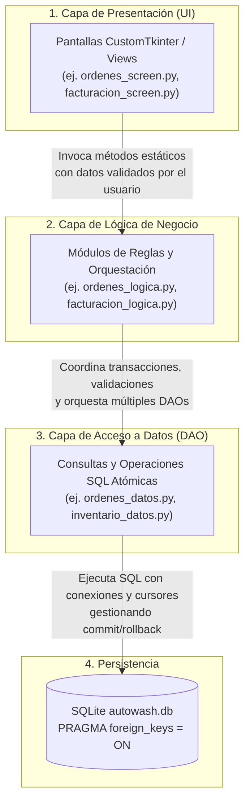

# Arquitectura del Sistema - AutoWash System

## 1. Principio y Flujo de Arquitectura

El sistema implementa una **Arquitectura en 3 Capas Estricta** (Layered Architecture). La comunicación entre componentes es **unidireccional y secuencial**:

$$\text{Presentación (UI)} \longrightarrow \text{Lógica de Negocio} \longrightarrow \text{Datos (DAO)} \longrightarrow \text{Base de Datos SQLite}$$



### Reglas de Diseño Estrictas
1. **Presentación (`presentacion/`):** Solo gestiona componentes visuales de CustomTkinter, eventos de usuario y presentación de datos en tablas (Treeview). **Nunca** realiza sentencias SQL, ni importa `sqlite3` o `db.conexion`.
2. **Lógica (`logica/`):** Valida entradas, aplica políticas del negocio (estados válidos, cálculos de totales, verificación de stock, integridad transaccional). **No contiene código SQL ni elementos de interfaz gráfica**. Retorna tuplas estandarizadas `(exito: bool, mensaje: str, ...)`.
3. **Datos (`datos/`):** Encapsula exclusivamente el acceso a la base de datos (Data Access Object - DAO). Prepara sentencias SQL parametrizadas para prevenir inyección SQL y maneja transacciones atómicas (`commit`/`rollback`).
4. **Base de Datos (`db/conexion.py`):** Centraliza la ruta dinámica de la base de datos (con soporte nativo para desarrollo y distribución de ejecutables vía PyInstaller) y habilita llaves foráneas (`PRAGMA foreign_keys = ON`).

---

## 2. Ejemplo Real de Arquitectura de Extremo a Extremo

Para ilustrar el patrón, se describe el flujo real del requerimiento **S5-08: Creación atómica de orden de servicio con descuento automático en inventario**:

### Paso 1: Capa de Presentación (`presentacion/ordenes_screen.py`)
El usuario completa el formulario en pantalla (selecciona vehículo, empleado y una lista de servicios) y presiona "Guardar Orden".

```python
# presentacion/ordenes_screen.py
from logica.ordenes_logica import OrdenesLogica

def guardar_orden(self):
    vehiculo_id = self.combo_vehiculo.obtener_id_seleccionado()
    empleado_id = self.combo_empleado.obtener_id_seleccionado()
    servicios_ids = self.obtener_servicios_marcados()

    # La vista delega completamente a la lógica
    exito, mensaje = OrdenesLogica.crear_orden_con_servicios(
        vehiculo_id=vehiculo_id,
        empleado_id=empleado_id,
        servicios_ids=servicios_ids
    )

    if exito:
        self.mostrar_notificacion_exito(mensaje)
        self.limpiar_formulario()
        self.recargar_tabla_ordenes()
    else:
        self.mostrar_alerta_error(mensaje)
```

---

### Paso 2: Capa de Lógica de Negocio (`logica/ordenes_logica.py`)
La capa lógica valida que el vehículo exista, que al menos un servicio haya sido seleccionado, calcula el total monetario y orquesta la transacción atómica a través de la capa de datos.

```python
# logica/ordenes_logica.py
from datos.ordenes_datos import OrdenesDatos
from datos.servicios_datos import ServiciosDatos

class OrdenesLogica:
    @staticmethod
    def crear_orden_con_servicios(vehiculo_id, empleado_id, servicios_ids):
        # 1. Reglas de Negocio / Validación
        if not vehiculo_id:
            return False, "Debe seleccionar un vehículo válido."
        if not servicios_ids or len(servicios_ids) == 0:
            return False, "Debe seleccionar al menos un servicio para la orden."

        # 2. Calcular montos congelados por servicio
        items_con_precio = []
        total = 0.0
        for s_id in servicios_ids:
            servicio = ServiciosDatos.obtener_por_id(s_id)
            if not servicio:
                return False, f"El servicio con ID {s_id} no existe."
            precio = float(servicio["precio"])
            items_con_precio.append((s_id, precio))
            total += precio

        # 3. Llamar al DAO que garantiza atomicidad (Orden + Detalles + Kardex de Stock)
        try:
            orden_id = OrdenesDatos.crear_orden_transaccional(
                vehiculo_id=vehiculo_id,
                empleado_id=empleado_id,
                total=total,
                detalles=items_con_precio
            )
            return True, f"Orden #{orden_id} registrada exitosamente."
        except Exception as e:
            return False, f"Error al procesar la orden: {str(e)}"
```

---

### Paso 3: Capa de Acceso a Datos (`datos/ordenes_datos.py`)
El DAO abre una única conexión, inicia la transacción y ejecuta de forma indivisible: la cabecera de la orden, los renglones de detalle, el consumo de insumos según recetas (`servicio_insumo`), la actualización de stock en `insumos` y el registro de auditoría en `movimientos_inventario`. Si cualquier paso falla, se ejecuta `rollback()`.

```python
# datos/ordenes_datos.py
from datetime import datetime
from db.conexion import obtener_conexion

class OrdenesDatos:
    @staticmethod
    def crear_orden_transaccional(vehiculo_id, empleado_id, total, detalles):
        conexion = obtener_conexion()
        cursor = conexion.cursor()
        fecha_hora = datetime.now().strftime("%Y-%m-%d %H:%M:%S")

        try:
            # 1. Insertar orden principal
            cursor.execute("""
                INSERT INTO ordenes_servicio (vehiculo_id, empleado_id, fecha_hora, total, estado)
                VALUES (?, ?, ?, ?, 'espera')
            """, (vehiculo_id, empleado_id, fecha_hora, total))
            orden_id = cursor.lastrowid

            # 2. Insertar cada servicio en orden_servicio_detalle y descontar insumos
            for servicio_id, precio in detalles:
                cursor.execute("""
                    INSERT INTO orden_servicio_detalle (orden_id, servicio_id, precio_aplicado)
                    VALUES (?, ?, ?)
                """, (orden_id, servicio_id, precio))

                # Buscar receta de insumos asociados al servicio
                cursor.execute("""
                    SELECT insumo_id, cantidad_consumida 
                    FROM servicio_insumo 
                    WHERE servicio_id = ?
                """, (servicio_id,))
                recetas = cursor.fetchall()

                # Descontar stock y registrar movimiento en Kardex
                for insumo_id, cant in recetas:
                    cursor.execute("""
                        UPDATE insumos 
                        SET stock_actual = stock_actual - ? 
                        WHERE id = ?
                    """, (cant, insumo_id))

                    cursor.execute("""
                        INSERT INTO movimientos_inventario 
                            (insumo_id, tipo_movimiento, cantidad, fecha_hora, orden_id, motivo)
                        VALUES (?, 'SALIDA', ?, ?, ?, ?)
                    """, (insumo_id, cant, fecha_hora, orden_id, f"Consumo orden #{orden_id}"))

            # Confirmar toda la operación de forma atómica
            conexion.commit()
            return orden_id

        except Exception as e:
            # Si ocurre cualquier error, deshacer todas las modificaciones
            conexion.rollback()
            raise e
        finally:
            conexion.close()
```

---

### Paso 4: Capa de Base de Datos (`db/autowash.db`)
El motor SQLite almacena los datos de forma consistente gracias a las restricciones `PRAGMA foreign_keys = ON`, registrando la cabecera en `ordenes_servicio`, los ítems en `orden_servicio_detalle`, actualizando las existencias en `insumos` y generando el histórico en `movimientos_inventario`.
