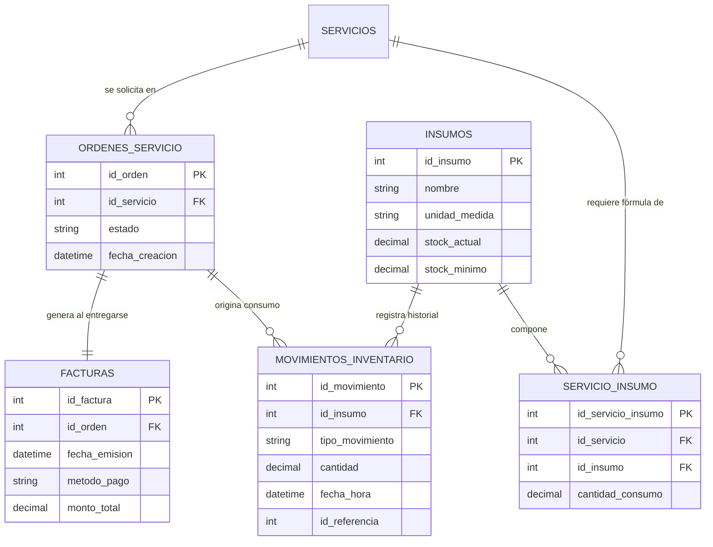

# DOCUMENTACIÓN TÉCNICA Y DE DESARROLLO
## SISTEMA DE GESTIÓN Y CONTROL DE SERVICIOS
### FASE DE DESARROLLO: SPRINT 3 Y SPRINT 4

---

**Información del Proyecto:**
- **Proyecto:** Sistema de Control Operativo, Inventario, Facturación y Reportes (Car Wash / Centro de Servicios)
- **Documento:** Especificación Técnica y Arquitectónica — Sprints 3 y 4
- **Versión:** 1.0.0
- **Fecha:** Octubre 2026
- **Tecnologías Principales:** Python 3.x, CustomTkinter, Matplotlib, SQLite / Motor Relacional SQL, PyInstaller

---

## 1. INTRODUCCIÓN Y ALCANCE GENERAL

El presente documento recopila de manera integral la arquitectura, diseño de base de datos, lógica de negocio e integración visual correspondientes al **Sprint 3** y **Sprint 4** del proyecto. 

El sistema ha sido concebido como una aplicación de escritorio moderna, robusta y modular, diseñada bajo una estricta **arquitectura en capas** que desacopla la persistencia de datos, las reglas de negocio y la presentación de usuario.

### Resumen de Objetivos por Sprint:
- **Sprint 3 (Backend — Inventario y Facturación):**
  - Modelado relacional para insumos, historial de movimientos y facturación.
  - Implementación de la tabla intermedia de recetas (`servicio_insumo`) para el descuento dinámico de insumos al ejecutar servicios.
  - Creación de módulos de acceso a datos y lógica (`inventario_datos.py`, `inventario_logica.py`, `facturacion_datos.py`, `facturacion_logica.py`).
  - Lógica de alertas de stock mínimo y emisión de comprobantes tras el cumplimiento del estado operativo "entregado".
- **Sprint 4 (Analítica — Arquitectura del Módulo de Reportes):**
  - Implementación de la capa de visualización e inteligencia de negocio usando **CustomTkinter** y **Matplotlib** embebido.
  - Cumplimiento de la compatibilidad total para empaquetado y distribución en ejecutable único con **PyInstaller**.
  - Conexión modular en 3 capas (`reportes_datos.py`, `reportes_logica.py`, `reportes_screen.py`) y enlace al dashboard central (`dashboard_view.py`, `main.py`).

---

## 2. SPRINT 3: BACKEND — INVENTARIO + FACTURACIÓN

### 2.1. Arquitectura y Enfoque de Diseño

El Sprint 3 consolida el núcleo transaccional del sistema. El objetivo prioritario es garantizar la integridad referencial y la consistencia en dos áreas críticas:
1. **Control de Inventario:** Saber con exactitud qué insumos existen, cuándo ingresan o salen, y descontar automáticamente los materiales consumidos cada vez que un servicio es prestado.
2. **Facturación y Cobro:** Emitir comprobantes de pago respaldados por una orden de servicio validada en estado **entregado**, registrando el método de pago y montos correspondientes.

```
       +-------------------------------------------------------+
       |                  ORDEN DE SERVICIO                    |
       |                (Estado: "entregado")                  |
       +---------------------------+---------------------------+
                                   |
         +-------------------------+-------------------------+
         |                                                   |
         v                                                   v
+------------------------+                  +--------------------------------+
|      FACTURACIÓN       |                  |      DESCUENTO DE STOCK        |
| - Método de Pago       |                  | - Consulta tabla intermedia    |
| - Emisión Comprobante  |                  |   servicio_insumo              |
| - Registro en facturas |                  | - Descuento en insumos         |
+------------------------+                  | - Registro en movimientos      |
                                            +--------------------------------+
```

---

### 2.2. Diseño y Modelado de Base de Datos

Para soportar las operaciones se establecieron y relacionaron las siguientes entidades:

#### A. Tabla `insumos` (o `inventario`)
Almacena el catálogo de productos y consumibles utilizados en la prestación de servicios (ej. shampoo para autos, cera líquida, desengrasante, aromatizante).

| Campo | Tipo de Dato | Clave / Restricción | Descripción |
| :--- | :--- | :--- | :--- |
| `id_insumo` | INTEGER | PRIMARY KEY AUTOINCREMENT | Identificador único del insumo |
| `nombre` | VARCHAR(100) | NOT NULL, UNIQUE | Nombre descriptivo del producto |
| `unidad_medida` | VARCHAR(20) | NOT NULL | Litros (L), Mililitros (ml), Unidades (u), etc. |
| `stock_actual` | DECIMAL(10,2) | NOT NULL, DEFAULT 0 | Existencia física disponible en almacén |
| `stock_minimo` | DECIMAL(10,2) | NOT NULL, DEFAULT 5 | Umbral para disparo de alertas de reposición |
| `costo_unitario`| DECIMAL(10,2) | NOT NULL, DEFAULT 0 | Costo de adquisición por unidad de medida |
| `estado` | VARCHAR(20) | DEFAULT 'ACTIVO' | Estado lógico del insumo (ACTIVO / INACTIVO) |

#### B. Tabla `movimientos_inventario`
Registra la auditoría completa (kardex) de cualquier variación en el stock físico para evitar inconsistencias o pérdidas.

| Campo | Tipo de Dato | Clave / Restricción | Descripción |
| :--- | :--- | :--- | :--- |
| `id_movimiento` | INTEGER | PRIMARY KEY AUTOINCREMENT | Identificador único del movimiento |
| `id_insumo` | INTEGER | FOREIGN KEY (`insumos.id_insumo`) | Insumo afectado |
| `tipo_movimiento`| VARCHAR(20) | CHECK IN ('ENTRADA', 'SALIDA_CONSUMO', 'AJUSTE') | Motivo de la alteración de inventario |
| `cantidad` | DECIMAL(10,2) | NOT NULL | Cantidad de unidades/litros desplazados |
| `fecha_hora` | DATETIME | DEFAULT CURRENT_TIMESTAMP | Momento exacto de la operación |
| `id_referencia` | INTEGER | NULLABLE | ID de la orden de servicio o factura asociada |
| `observaciones` | TEXT | NULLABLE | Detalle o justificación del movimiento |

#### C. Tabla Intermedia `servicio_insumo` (Receta / Matriz de Consumo)
Resuelve la relación muchos a muchos entre los servicios ofrecidos y los insumos requeridos. Define el consumo estándar programado por cada tipo de servicio.

*Ejemplo:* El servicio *"Lavado Básico"* consume 2.0 litros de shampoo y 0.5 litros de cera.

| Campo | Tipo de Dato | Clave / Restricción | Descripción |
| :--- | :--- | :--- | :--- |
| `id_servicio_insumo` | INTEGER | PRIMARY KEY AUTOINCREMENT | Identificador del registro de fórmula |
| `id_servicio` | INTEGER | FOREIGN KEY (`servicios.id_servicio`) | Servicio al que aplica la fórmula |
| `id_insumo` | INTEGER | FOREIGN KEY (`insumos.id_insumo`) | Insumo consumido |
| `cantidad_consumo` | DECIMAL(10,2) | NOT NULL | Cantidad estándar que descuenta cada servicio |

#### D. Tabla `facturas` (o Extensión de `ordenes_servicio`)
Consolida el cobro formal del servicio. Se modela como tabla dedicada vinculada a la orden de servicio para preservar el histórico fiscal y registrar el método de pago.

| Campo | Tipo de Dato | Clave / Restricción | Descripción |
| :--- | :--- | :--- | :--- |
| `id_factura` | INTEGER | PRIMARY KEY AUTOINCREMENT | Número único de comprobante/factura |
| `id_orden` | INTEGER | FOREIGN KEY (`ordenes_servicio.id_orden`), UNIQUE | Orden finalizada que da origen al cobro |
| `fecha_emision` | DATETIME | DEFAULT CURRENT_TIMESTAMP | Fecha y hora de generación de la factura |
| `metodo_pago` | VARCHAR(30) | NOT NULL | 'Efectivo', 'Tarjeta Débito/Crédito', 'Transferencia' |
| `monto_subtotal`| DECIMAL(10,2) | NOT NULL | Base imponible del servicio |
| `monto_impuesto`| DECIMAL(10,2) | DEFAULT 0 | Impuestos aplicables |
| `monto_total` | DECIMAL(10,2) | NOT NULL | Total liquidado y cancelado |
| `estado_factura`| VARCHAR(20) | DEFAULT 'PAGADA' | 'PAGADA', 'ANULADA' |

---

### 2.3. Estructura de Módulos y Lógica de Negocio

La separación de responsabilidades para el Sprint 3 se organiza en:

```
src/
├── datos/
│   ├── inventario_datos.py    # Consultas SQL directas, transacciones de stock y kardex
│   └── facturacion_datos.py   # Inserción de facturas, consultas de comprobantes por orden
└── logica/
    ├── inventario_logica.py   # Reglas de negocio de stock, alertas y consumo de recetas
    └── facturacion_logica.py  # Validación de estado 'entregado', cálculo total y emisión
```

#### Módulo de Inventario (`inventario_datos.py` & `inventario_logica.py`)
1. **CRUD de Insumos:**
   - Crear nuevos insumos verificando unicidad de nombre.
   - Listado con cálculo de estado de inventario.
   - Modificación de datos base (precios, stock mínimo, unidad de medida).
   - Eliminación lógica o bloqueo de borrado si el insumo ya cuenta con movimientos registrados.
2. **Descuento Automático de Stock:**
   - Al finalizar o entregar un servicio, el sistema lee los registros vinculados en `servicio_insumo`.
   - Por cada insumo asociado, ejecuta en una **transacción atómica** el débito en `insumos.stock_actual` y la inserción del registro correspondiente en `movimientos_inventario` con tipo `SALIDA_CONSUMO`.
   - Si no hay suficiente stock disponible, genera una notificación preventiva o bloquea la operación según la directriz configurada.
3. **Alertas de Stock Bajo:**
   - Evaluación continua de la condición: `stock_actual <= stock_minimo`.
   - Disparo de bandera o lista de alertas visuales en panel de administración para reabastecimiento urgente.

#### Módulo de Facturación (`facturacion_datos.py` & `facturacion_logica.py`)
1. **Validación de Regla de Negocio:**
   - Ninguna factura puede ser generada si la orden asociada no se encuentra en estado estricto: **"entregado"**.
   - Se valida que la orden no haya sido facturada previamente (evitando doble facturación mediante constraint `UNIQUE` en `id_orden`).
2. **Generación de Comprobante:**
   - Recepción y normalización del método de pago (Efectivo, Tarjeta, Transferencia).
   - Cálculo automático de totales basados en los servicios asociados a la orden.
   - Registro atómico de la factura y entrega de resumen para impresión o visualización en pantalla.

---

### 2.4. Matriz de Dependencias y Trabajo en Equipo

| Componente | Requisito Previo | Estado / Dependencia | Responsable / Situación |
| :--- | :--- | :--- | :--- |
| **Módulo de Inventario** | Ninguno. Módulo completamente desacoplado y autónomo. | **Listo para desarrollo inmediato** | Inicia sin bloqueos. |
| **Módulo de Facturación** | Flujo de 4 estados de la orden completado por el compañero (`recibido` $\rightarrow$ `en_proceso` $\rightarrow$ `terminado` $\rightarrow$ `entregado`). | **Desbloqueado (Listo)** | El estado `entregado` ya se encuentra validado y operativo por el equipo, permitiendo el desarrollo inmediato de la facturación. |

---

## 3. SPRINT 4: ARQUITECTURA DEL MÓDULO DE REPORTES

### 3.1. Stack Tecnológico y Criterios de Selección

El módulo de reportes y analítica visual se implementa bajo estándares rigurosos de estabilidad y ligereza para entornos de escritorio Windows:

```
+-----------------------------------------------------------------------+
|                         STACK TECNOLÓGICO                             |
+-----------------------------------------------------------------------+
| Interfaz Gráfica (UI):  CustomTkinter (Modo Oscuro/Claro, Moderno)   |
| Motor de Gráficas:      Matplotlib embebido (FigureCanvasTkAgg)       |
| Acceso a Datos:         SQL ANSI / Consultas de Agregación            |
| Empaquetador Final:     PyInstaller (--onefile / --noconsole)         |
+-----------------------------------------------------------------------+
```

#### Criterios de Diseño Clave:
1. **CustomTkinter:** Proporciona componentes visuales pulidos, soporte nativo para escalado de alta densidad (DPI scaling) y temas personalizables acordes a la identidad del sistema.
2. **Matplotlib Embebido vs. Librerías Web (Plotly/ECharts):**
   - Se descartó el uso de motores basados en Chromium embebido (como Electron o CEF) o servidores web locales, ya que sobrecargan la memoria RAM y añaden fragilidad al despliegue.
   - **Matplotlib integrado vía `FigureCanvasTkAgg`** permite renderizar gráficos vectoriales directamente en lienzos nativos de Tkinter sin dependencias externas pesadas.
3. **Estabilidad con PyInstaller:**
   - La arquitectura evita librerías con componentes nativos complejos que fallan durante el congelamiento a binario `.exe`.
   - Matplotlib + CustomTkinter cuenta con soporte directo y probado para compilación limpia con PyInstaller.

---

### 3.2. Patrón de Arquitectura: Separación de Capas

El módulo sigue de forma estricta la arquitectura desacoplada del sistema:

```
[ Capa de Presentación: presentacion/reportes_screen.py ]
                           |
                           v  (Datos validados / DataFrames / Listas)
[ Capa de Lógica: logica/reportes_logica.py ]
                           |
                           v  (Solicitud de consultas parametrizadas)
[ Capa de Datos: datos/reportes_datos.py ]
                           |
                           v  (Ejecución de SQL Aggregations)
[ Base de Datos Relacional: SQLite / motor SQL ]
```

#### 1. Capa de Datos (`datos/reportes_datos.py`)
Se encarga exclusivamente del acceso físico a los datos mediante sentencias SQL optimizadas con funciones agregadas (`SUM`, `COUNT`, `AVG`, `GROUP BY`, `BETWEEN`).

*Consultas Principales:*
- **Ingresos por Rango de Fechas:** Agrupación cronológica de montos cobrados en `facturas` filtrados por fecha de emisión.
- **Servicios Más Vendidos:** Conteo de solicitudes por servicio a partir de las órdenes completadas.
- **Consumo de Insumos:** Sumatoria de cantidades descontadas en `movimientos_inventario` (tipo `SALIDA_CONSUMO`) en un período de tiempo.

#### 2. Capa de Lógica (`logica/reportes_logica.py`)
Implementa las reglas de procesamiento analítico y sanitización de datos:
- Validación de rangos cronológicos (que la fecha de inicio sea menor o igual a la fecha de fin y no pertenezca al futuro).
- Conversión de tipos de datos, formateo de valores monetarios (ej. `$ 150,000.00 COP`) y unidades de volumen/peso.
- Transformación y estructuración de los datos en series numéricas para los ejes $X$ e $Y$ de los gráficos.
- Cálculo de métricas e indicadores de rendimiento (KPIs: Ingreso promedio diario, servicio estrella, insumo con mayor rotación).

#### 3. Capa de Presentación (`presentacion/reportes_screen.py`)
Contiene la interfaz de usuario interactiva:
- Selectores y campos para filtros de fechas (períodos rápidos: Hoy, Última Semana, Mes Actual, Personalizado).
- Paneles tipo tarjeta (Cards) para resumen de KPIs principales.
- Tablas con vista detallada de registros.
- Lienzos de visualización gráfica embebida con Matplotlib:
  - Gráfico de Líneas/Barras para evolución de ingresos temporales.
  - Gráfico de Torta (Pie Chart) o Barras Horizontales para distribución porcentual de servicios prestados.
  - Gráfico de Barras para consumo de insumos críticos.

#### 4. Integración Centralizada (`dashboard_view.py` y `main.py`)
El módulo de reportes no funciona de forma aislada; se conecta mediante el menú de navegación lateral en `dashboard_view.py`. Al seleccionarse la opción *"Reportes"*, la vista se instancia dinámicamente en el contenedor central de la aplicación, preservando la navegación unificada junto a los módulos de Inventario y Facturación.

---

### 3.3. Persistencia y Modelado Integral de Datos

El diseño de reportes se apoya directamente en el esquema unificado documentado en el archivo del proyecto `Dso/der.md`. Todas las consultas se basan en relaciones normalizadas, garantizando que los datos visualizados en los reportes sean 100% fieles a las transacciones ejecutadas en el taller.



---

## 4. ESTRATEGIA DE EMPAQUETADO Y DESPLIEGUE (PyInstaller)

Para asegurar que la aplicación final sea distribuible a usuarios finales sin requerir un entorno Python previamente instalado, se contemplan las siguientes pautas técnicas:

1. **Inclusión de Fuentes y Assets de CustomTkinter:**
   - Asegurar que los temas `.json` y fuentes tipográficas de CustomTkinter sean reconocidos usando el parámetro `--collect-all customtkinter`.
2. **Backend de Matplotlib para Tkinter:**
   - Forzar explícitamente en el código fuente la asignación del backend interactivo:
     ```python
     import matplotlib
     matplotlib.use('TkAgg')
     from matplotlib.backends.backend_tkagg import FigureCanvasTkAgg
     ```
3. **Estructura Monolítica de Compilación:**
   - Comando recomendado para la generación del ejecutable:
     ```bash
     pyinstaller --noconsole --onefile --name "SistemaServicios" \
       --collect-all customtkinter \
       --collect-data matplotlib \
       main.py
     ```

---

## 5. CONCLUSIÓN Y ESTADO DEL PROYECTO

- **Sprint 3:** El backend de inventario y facturación cuenta con su diseño relacional completo, las tablas intermedias de consumo definidas y la sincronización con el estado `entregado` de la orden de servicio.
- **Sprint 4:** La arquitectura del módulo de reportes garantiza una solución visual moderna, altamente desacoplada y 100% compatible con compilación en entornos de producción de escritorio.
- El proyecto mantiene una rigurosa separación de capas (`datos/`, `logica/`, `presentacion/`), lo cual facilita el mantenimiento preventivo, la realización de pruebas unitarias y la escalabilidad del sistema.
