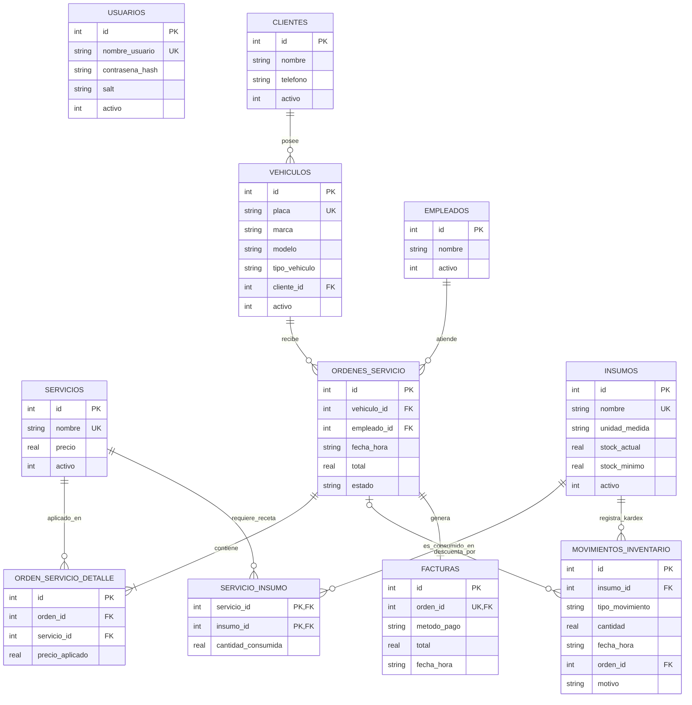

# Diagrama Entidad-Relación (DER) - AutoWash System

El sistema implementa un modelo relacional en SQLite compuesto por **11 tablas** principales que soportan la autenticación, administración de clientes y vehículos, asignación de empleados, catálogo de servicios, control de inventario con recetas automáticas, ciclo de vida de órdenes y facturación.

---

## 1. Diagrama Entidad-Relación (Mermaid)

---

## 2. Diccionario de Datos de las 11 Tablas

### 1. `usuarios`
Almacena las credenciales de acceso al sistema con hashing y salting criptográfico.
* `id` (INTEGER, PK): Identificador único del usuario.
* `nombre_usuario` (TEXT, UNIQUE): Nombre de usuario para inicio de sesión.
* `contrasena_hash` (TEXT): Hash PBKDF2/SHA256 de la contraseña.
* `salt` (TEXT): Sal única generada para el usuario.
* `activo` (INTEGER): Estado lógico (1 = activo, 0 = inactivo).

### 2. `clientes`
Registro de personas naturales o empresas que solicitan servicios.
* `id` (INTEGER, PK): Identificador único del cliente.
* `nombre` (TEXT): Nombre completo o razón social.
* `telefono` (TEXT): Teléfono de contacto.
* `activo` (INTEGER): Borrado lógico (1 = activo, 0 = inactivo).

### 3. `vehiculos`
Vehículos atendidos en el lavadero, vinculados a un cliente.
* `id` (INTEGER, PK): Identificador único del vehículo.
* `placa` (TEXT, UNIQUE): Placa o matrícula única.
* `marca` (TEXT): Marca del vehículo (ej. Toyota, Chevrolet).
* `modelo` (TEXT): Modelo y línea (ej. Hilux, Aveo).
* `tipo_vehiculo` (TEXT): Clasificación (Sedan, SUV, Camioneta, Moto).
* `cliente_id` (INTEGER, FK $\to$ `clientes.id`): Propietario del vehículo.
* `activo` (INTEGER): Borrado lógico (1 = activo, 0 = inactivo).

### 4. `empleados`
Operarios y lavadores encargados de ejecutar las órdenes de servicio.
* `id` (INTEGER, PK): Identificador único del empleado.
* `nombre` (TEXT): Nombre completo del empleado.
* `activo` (INTEGER): Borrado lógico (1 = activo, 0 = inactivo).

### 5. `servicios`
Catálogo de servicios disponibles en el autolavado.
* `id` (INTEGER, PK): Identificador único del servicio.
* `nombre` (TEXT, UNIQUE): Nombre descriptivo (ej. "Lavado Básico", "Polichado").
* `precio` (REAL): Costo monetario vigente del servicio.
* `activo` (INTEGER): Borrado lógico (1 = activo, 0 = inactivo).

### 6. `ordenes_servicio`
Cabecera de la orden de trabajo para un vehículo.
* `id` (INTEGER, PK): Identificador único de la orden.
* `vehiculo_id` (INTEGER, FK $\to$ `vehiculos.id`): Vehículo atendido.
* `empleado_id` (INTEGER, FK $\to$ `empleados.id`): Operario asignado (opcional).
* `fecha_hora` (TEXT): Estampa ISO (YYYY-MM-DD HH:MM:SS) de registro.
* `total` (REAL): Importe total consolidado de la orden.
* `estado` (TEXT): Ciclo de vida (`'espera'`, `'proceso'`, `'listo'`, `'entregado'`).

### 7. `orden_servicio_detalle`
Ítems o líneas de servicio solicitados en una orden específica.
* `id` (INTEGER, PK): Identificador único del detalle.
* `orden_id` (INTEGER, FK $\to$ `ordenes_servicio.id`): Orden a la que pertenece.
* `servicio_id` (INTEGER, FK $\to$ `servicios.id`): Servicio aplicado.
* `precio_aplicado` (REAL): Precio histórico congelado al momento del registro.

### 8. `insumos`
Inventario de productos y materiales químicos utilizados en los lavados.
* `id` (INTEGER, PK): Identificador único del insumo.
* `nombre` (TEXT, UNIQUE): Nombre del producto (ej. "Shampoo Siliconado", "Cera en Pasta").
* `unidad_medida` (TEXT): Unidad de cuantificación (ml, gramos, litros, unidades).
* `stock_actual` (REAL): Existencia actual disponible.
* `stock_minimo` (REAL): Umbral para disparar alertas de reabastecimiento.
* `activo` (INTEGER): Borrado lógico (1 = activo, 0 = inactivo).

### 9. `movimientos_inventario`
Kardex y auditoría de variaciones en las existencias de insumos.
* `id` (INTEGER, PK): Identificador único del movimiento.
* `insumo_id` (INTEGER, FK $\to$ `insumos.id`): Insumo afectado.
* `tipo_movimiento` (TEXT): `'ENTRADA'`, `'SALIDA'`, `'AJUSTE'`.
* `cantidad` (REAL): Magnitud del cambio en unidades del insumo.
* `fecha_hora` (TEXT): Fecha y hora del movimiento.
* `orden_id` (INTEGER, FK $\to$ `ordenes_servicio.id`): Orden que causó el consumo (si aplica).
* `motivo` (TEXT): Explicación del movimiento (ej. "Consumo orden #14", "Compra lote").

### 10. `servicio_insumo`
Tabla de relación muchos a muchos ("receta") que define el consumo estándar de insumos por cada servicio.
* `servicio_id` (INTEGER, PK, FK $\to$ `servicios.id`): Servicio ofertado.
* `insumo_id` (INTEGER, PK, FK $\to$ `insumos.id`): Insumo que requiere.
* `cantidad_consumida` (REAL): Cantidad del insumo descontada por cada ejecución del servicio.

### 11. `facturas`
Comprobante de pago y cierre contable de una orden de servicio.
* `id` (INTEGER, PK): Número de factura único.
* `orden_id` (INTEGER, UNIQUE, FK $\to$ `ordenes_servicio.id`): Orden facturada (relación 1:1).
* `metodo_pago` (TEXT): Medio de cancelación (`'Efectivo'`, `'Transferencia'`, `'Tarjeta'`, etc.).
* `total` (REAL): Monto total facturado.
* `fecha_hora` (TEXT): Momento de emisión del comprobante.
